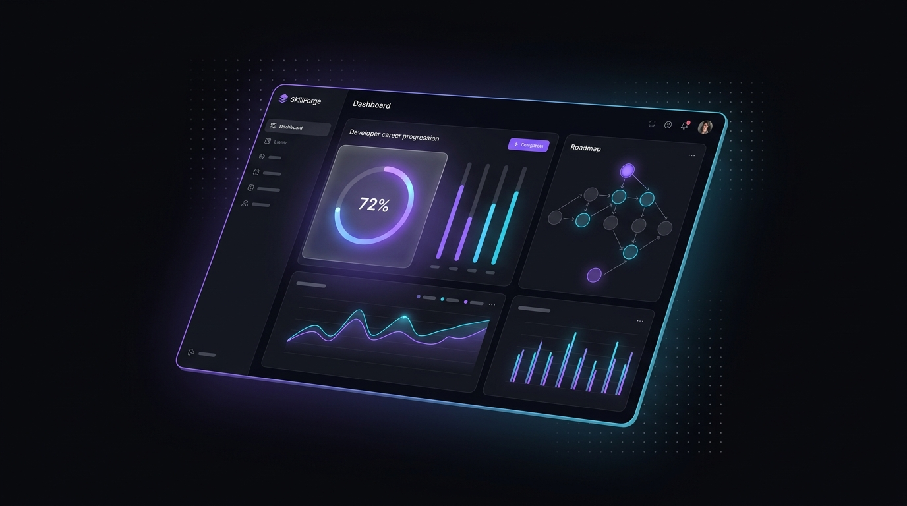
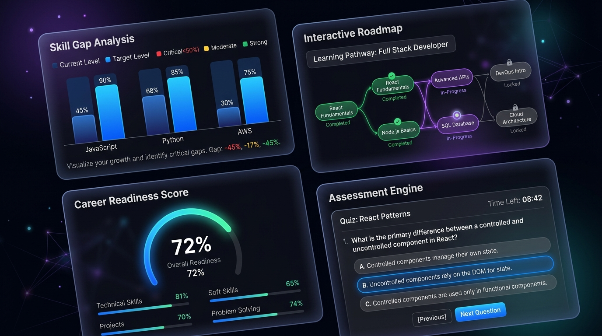
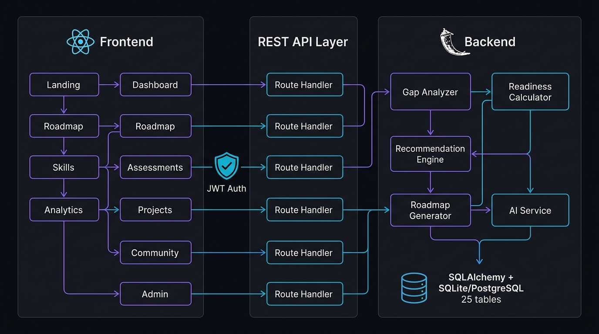
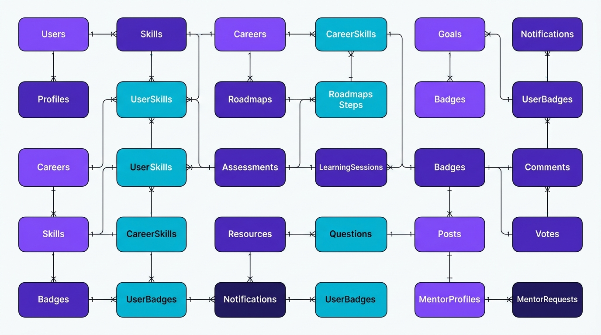

<p align="center">
  
</p>

<h1 align="center">⚡ SkillForge</h1>

<p align="center">
  <strong>"Forge the skills. Build the career."</strong>
</p>

<p align="center">
  A personalized learning, skill-gap analysis, dynamic roadmap generation,<br/>
  project tracking, and career-readiness platform for developers.
</p>

<p align="center">
  
  
  
  
  
  
  
  
</p>

<p align="center">
  <a href="#-quick-start">Quick Start</a> •
  <a href="#-key-features">Features</a> •
  <a href="#-system-architecture">Architecture</a> •
  <a href="#-api-reference">API Reference</a> •
  <a href="#-database-schema">Database</a> •
  <a href="#-demo-accounts">Demo</a>
</p>

---

## 🌟 Product Vision

SkillForge systematically guides developers by answering five critical career questions:

| # | Question | How SkillForge Answers It |
|---|----------|--------------------------|
| 1 | **Where am I currently?** | Audits verified competencies via assessments and tracked learning sessions |
| 2 | **What skills do I need?** | Reverse-engineers industry benchmark requirements across 10+ career paths |
| 3 | **What am I missing?** | Visualizes skill gaps categorized as *Critical*, *Moderate*, or *Mastered* |
| 4 | **What should I learn next?** | Generates **Next Best Actions** with signature **"ⓘ Why this?"** explanations |
| 5 | **Am I actually job-ready?** | Calculates a multi-factor **Career Readiness Index** (Skills 40% · Projects 25% · Assessments 20% · Consistency 15%) |

---

## 🎨 Design Philosophy

Inspired by **Linear**, **Vercel**, **Notion**, and modern developer observability dashboards:

| Design Element | Implementation |
|---|---|
| **Color Architecture** | Deep obsidian `#090a0f` · Charcoal cards `#11131c` · Electric violet `#8b5cf6` · Cyber cyan `#06b6d4` · Emerald `#10b981` · Amber `#f59e0b` |
| **Surface System** | Glassmorphism with `backdrop-filter: blur(16px)` · Micro-dot ambient grids · Radiant glow nodes |
| **Typography** | *Plus Jakarta Sans* (geometric sans-serif) · *JetBrains Mono* (monospace numerals) |
| **Interactions** | Framer Motion page/component transitions · Command palette (`⌘K`) · Animated progress rings |

---

## 🚀 Key Features

<p align="center">
  
</p>

### 1. 📊 Deep Skill Gap Analysis
- Dual-bar visual comparisons: **current proficiency** vs. **industry benchmark**
- Categorized status tags: *Critical Gap* · *Moderate Gap* · *Strong / Mastered*
- Filterable by category (Frontend, Backend, Database, DevOps, AI/ML, System Design)

### 2. 🗺️ Interactive Graph Curriculum & Roadmaps
- Non-linear DAG dependency graph showing: `Completed` · `In Progress` · `Recommended` · `Available` · `Locked`
- Side inspection panel with prerequisite checkmarks, topic checklists, linked resources, and assessments
- Career-specific roadmap generation via the **Roadmap Generator** service

### 3. 🧠 Signature "Why This?" Explainability Engine
- Every recommendation explains its rationale (prerequisites completed, target role requirements, assessment weak areas, time bandwidth)
- AI-powered explanations via deterministic reasoning templates
- Transparent recommendation scoring breakdown

### 4. ✅ Verified Assessment & Quiz Engine
- Timed MCQ and scenario-based questions with instant scoring
- Diagnostic report cards highlighting **Strong Concepts** vs. **Remediation Areas**
- Assessment history tracking with score trend visualization

### 5. 🔨 Portfolio Project Forge
- Track projects across lifecycle: `Idea` → `Planning` → `Building` → `Completed`
- Milestone checklists with completion tracking
- Simulated GitHub commit activity and language breakdowns

### 6. 📈 FinTech-Style Analytics & Career Readiness Score
- Interactive Radar charts comparing proficiency across skill categories
- 7-day study distribution bar charts
- Assessment score history timeline
- Composite readiness index with weighted factor breakdown

### 7. 👥 Developer Community & Mentor Network
- Community discussion threads with markdown formatting and upvoting
- Mentor directory with 1:1 booking requests
- Role-specific views for students and mentors

### 8. 🛡️ RBAC & Admin Control Center
- Three role tiers: `Student` · `Mentor` · `Admin`
- Admin CRUD for users, skills, and learning resources
- **1-click Role Switcher** in the header for instant role preview

### 9. 🎯 Goal Setting & Achievement System
- Create goals with milestone breakdowns
- Badge & achievement system for learning milestones
- Streak tracking for daily learning consistency

### 10. 🔍 Command Palette
- `⌘K` / `Ctrl+K` quick navigation across all pages
- Instant search with fuzzy matching
- Keyboard-first navigation experience

---

## 🏗️ System Architecture

<p align="center">
  
</p>

```
┌─────────────────────────────────────────────────────────────────────┐
│                        FRONTEND (React 19 + TypeScript)             │
│                                                                     │
│  Landing ─► Onboarding ─► Dashboard ─► Roadmap / Skills / etc.     │
│  ├── 17 Page Components    ├── Zustand State    ├── TanStack Query  │
│  ├── Framer Motion          ├── Recharts         └── Lucide Icons   │
│  └── Tailwind CSS v4 + Custom Glassmorphism Token System            │
├─────────────────────────────────────────────────────────────────────┤
│                      REST API (Vite Dev Proxy → /api)               │
├─────────────────────────────────────────────────────────────────────┤
│                        BACKEND (Flask 3.0 + Python 3.13)            │
│                                                                     │
│  ├── 18 Route Blueprints (auth, profile, careers, skills, roadmap,  │
│  │    assessments, resources, projects, learning, analytics,        │
│  │    recommendations, goals, achievements, community, mentors,     │
│  │    notifications, admin, github)                                 │
│  │                                                                  │
│  ├── 5 Intelligence Services                                       │
│  │    ├── GapAnalyzer        — Skill gap quantification             │
│  │    ├── ReadinessCalculator — Multi-factor readiness index        │
│  │    ├── RecommendationEngine — Next action generation             │
│  │    ├── RoadmapGenerator    — DAG layout computation              │
│  │    └── AIService           — Deterministic reasoning engine      │
│  │                                                                  │
│  ├── JWT Authentication (Flask-JWT-Extended)                        │
│  └── CORS + Global Error Handling                                   │
├─────────────────────────────────────────────────────────────────────┤
│                    DATABASE (SQLAlchemy 2.0 ORM)                    │
│                                                                     │
│  SQLite (zero-config default) ←→ PostgreSQL (production-ready)      │
│  25 normalized tables · 806 lines of model definitions              │
└─────────────────────────────────────────────────────────────────────┘
```

---

## 🛠️ Technology Stack

### Frontend

| Technology | Version | Purpose |
|---|---|---|
| **React** | 19.2 | Component framework with hooks |
| **TypeScript** | 6.0 | Type-safe development |
| **Vite** | 8.3 | Build tool with HMR |
| **Tailwind CSS** | 4.3 | Utility-first styling + custom design tokens |
| **React Router DOM** | 7.x | Client-side routing (17 routes) |
| **TanStack Query** | 5.x | Server state management with caching |
| **Zustand** | 5.x | Client state management (auth/theme) |
| **Recharts** | 3.x | Data visualization (radar, bar, line charts) |
| **Framer Motion** | 13.x | Page transitions & micro-animations |
| **Lucide React** | 1.x | Icon system |

### Backend

| Technology | Version | Purpose |
|---|---|---|
| **Python** | 3.13 | Runtime |
| **Flask** | 3.0 | Web framework |
| **SQLAlchemy** | 2.0 | ORM with full relationship mapping |
| **Flask-JWT-Extended** | 4.6 | JWT authentication & authorization |
| **Flask-CORS** | 4.0 | Cross-origin resource sharing |
| **Werkzeug** | 3.0 | Password hashing (PBKDF2-SHA256) |
| **Pytest** | 8.2 | Automated testing |

---

## ⚡ Quick Start

### Prerequisites
- **Python** 3.11+
- **Node.js** 18+ (npm 9+)

### 1. Clone the Repository

```bash
git clone https://github.com/ashutosh2453/SKILLFORGE-FULL-STACK-APPLICATION.git
cd SKILLFORGE-FULL-STACK-APPLICATION
```

### 2. Start the Backend API

```bash
cd backend

# Install dependencies
pip install -r requirements.txt

# Start the server (auto-seeds database on first launch)
python run.py
```

> ✅ API starts on `http://127.0.0.1:5000`
> The database is automatically created and populated with rich seed data on first run.

### 3. Start the Frontend

```bash
cd frontend

# Install dependencies
npm install

# Start Vite dev server
npm run dev
```

> ✅ Open `http://localhost:5173` in your browser.

### 4. Environment Variables (Optional)

Copy `.env.example` to `backend/.env` to customize settings:

```bash
cp .env.example backend/.env
```

| Variable | Default | Description |
|---|---|---|
| `FLASK_ENV` | `development` | Flask environment mode |
| `PORT` | `5000` | Backend server port |
| `SECRET_KEY` | (preset) | Flask secret key |
| `JWT_SECRET_KEY` | (preset) | JWT signing key |
| `DATABASE_URL` | `sqlite:///skillforge.db` | Database URI (supports PostgreSQL) |

---

## 👥 Demo Accounts

The database is pre-seeded with three demo accounts:

| Role | Username | Email | Password | Profile |
|---|---|---|---|---|
| 🎓 **Student** | `ashutosh` | `student@skillforge.io` | `password123` | Full Stack roadmap · 6-day streak · 72% Readiness |
| 🧑‍🏫 **Mentor** | `sarah.chen` | `mentor@skillforge.io` | `password123` | Principal Architect @ Stripe · Accepts review requests |
| 🔧 **Admin** | `admin` | `admin@skillforge.io` | `password123` | Full system control · Skill catalog CRUD |

> **💡 Tip:** Use the **Role Switcher** pills in the header to instantly preview any role without logging out.

---

## 📡 API Reference

### Authentication

| Method | Endpoint | Description | Auth |
|---|---|---|---|
| `POST` | `/api/auth/register` | Register new user | ❌ |
| `POST` | `/api/auth/login` | Login with credentials | ❌ |
| `POST` | `/api/auth/demo-login` | Quick demo role login | ❌ |
| `GET` | `/api/auth/me` | Get authenticated user | ✅ |

### Profile & Onboarding

| Method | Endpoint | Description | Auth |
|---|---|---|---|
| `GET` | `/api/profile` | Get user profile | ✅ |
| `PUT` | `/api/profile` | Update profile | ✅ |
| `POST` | `/api/profile/onboarding` | Complete onboarding flow | ✅ |

### Careers & Skills

| Method | Endpoint | Description | Auth |
|---|---|---|---|
| `GET` | `/api/careers` | List all career paths | ❌ |
| `GET` | `/api/careers/:id` | Career details with skills | ❌ |
| `GET` | `/api/skills` | List all skills | ✅ |
| `GET` | `/api/skills/:id` | Skill details | ✅ |
| `GET` | `/api/skills/matrix` | Full skill proficiency matrix | ✅ |
| `GET` | `/api/skills/gap-analysis` | Skill gap analysis report | ✅ |
| `POST` | `/api/skills/update-level` | Update skill proficiency | ✅ |

### Roadmap

| Method | Endpoint | Description | Auth |
|---|---|---|---|
| `GET` | `/api/roadmap` | Get user's roadmap | ✅ |
| `GET` | `/api/roadmap/:career_id` | Career-specific roadmap graph | ✅ |
| `POST` | `/api/roadmap/step/:id/toggle-topic` | Toggle topic completion | ✅ |
| `POST` | `/api/roadmap/step/:id/complete` | Mark step complete | ✅ |

### Assessments

| Method | Endpoint | Description | Auth |
|---|---|---|---|
| `GET` | `/api/assessments` | List available assessments | ✅ |
| `GET` | `/api/assessments/:id` | Assessment with questions | ✅ |
| `POST` | `/api/assessments/:id/submit` | Submit assessment answers | ✅ |
| `GET` | `/api/assessments/history` | Assessment attempt history | ✅ |

### Projects

| Method | Endpoint | Description | Auth |
|---|---|---|---|
| `GET` | `/api/projects` | List user projects | ✅ |
| `POST` | `/api/projects` | Create new project | ✅ |
| `PUT` | `/api/projects/:id` | Update project | ✅ |
| `DELETE` | `/api/projects/:id` | Delete project | ✅ |
| `POST` | `/api/projects/:id/milestones/:mid/toggle` | Toggle milestone | ✅ |

### Learning & Analytics

| Method | Endpoint | Description | Auth |
|---|---|---|---|
| `GET` | `/api/learning/sessions` | Learning session history | ✅ |
| `POST` | `/api/learning/sessions` | Log a learning session | ✅ |
| `GET` | `/api/learning/weekly-chart` | 7-day study distribution | ✅ |
| `GET` | `/api/analytics/overview` | Full analytics overview | ✅ |
| `GET` | `/api/analytics/career-readiness` | Career readiness breakdown | ✅ |

### Recommendations

| Method | Endpoint | Description | Auth |
|---|---|---|---|
| `GET` | `/api/recommendations/next-action` | Next best action | ✅ |
| `GET` | `/api/recommendations/weekly-plan` | Weekly study plan | ✅ |
| `POST` | `/api/recommendations/ai-explain` | AI-powered skill explanation | ✅ |
| `POST` | `/api/recommendations/ai-project-idea` | AI project idea generator | ✅ |

### Community & Mentors

| Method | Endpoint | Description | Auth |
|---|---|---|---|
| `GET` | `/api/community/posts` | List discussion posts | ✅ |
| `POST` | `/api/community/posts` | Create a post | ✅ |
| `POST` | `/api/community/posts/:id/vote` | Upvote/downvote a post | ✅ |
| `GET` | `/api/community/posts/:id/comments` | Get comments | ✅ |
| `POST` | `/api/community/posts/:id/comments` | Add a comment | ✅ |
| `GET` | `/api/mentors` | List mentors | ✅ |
| `POST` | `/api/mentors/:id/request` | Send mentor request | ✅ |
| `GET` | `/api/mentors/my-requests` | View your requests | ✅ |
| `PUT` | `/api/mentors/requests/:id/status` | Accept/decline request | ✅ |

### Goals, Achievements & Notifications

| Method | Endpoint | Description | Auth |
|---|---|---|---|
| `GET` | `/api/goals` | List user goals | ✅ |
| `POST` | `/api/goals` | Create a goal | ✅ |
| `POST` | `/api/goals/:id/toggle-milestone` | Toggle goal milestone | ✅ |
| `DELETE` | `/api/goals/:id` | Delete goal | ✅ |
| `GET` | `/api/achievements` | User badges & achievements | ✅ |
| `GET` | `/api/notifications` | List notifications | ✅ |
| `POST` | `/api/notifications/:id/read` | Mark as read | ✅ |
| `POST` | `/api/notifications/read-all` | Mark all as read | ✅ |

### Admin

| Method | Endpoint | Description | Auth |
|---|---|---|---|
| `GET` | `/api/admin/users` | List all users | 🔒 Admin |
| `PUT` | `/api/admin/users/:id/role` | Update user role | 🔒 Admin |
| `DELETE` | `/api/admin/users/:id` | Delete user | 🔒 Admin |
| `POST` | `/api/admin/skills` | Create skill | 🔒 Admin |
| `PUT` | `/api/admin/skills/:id` | Update skill | 🔒 Admin |
| `DELETE` | `/api/admin/skills/:id` | Delete skill | 🔒 Admin |
| `POST` | `/api/admin/resources` | Create resource | 🔒 Admin |

### System

| Method | Endpoint | Description | Auth |
|---|---|---|---|
| `GET` | `/api/health` | Health check endpoint | ❌ |
| `GET` | `/api/github/sync-status` | GitHub sync status | ✅ |

---

## 🗄️ Database Schema

<p align="center">
  
</p>

### 25 Normalized Tables

| Domain | Tables | Purpose |
|---|---|---|
| **Identity** | `users` · `profiles` | Authentication, roles, onboarding state |
| **Career Mapping** | `careers` · `skills` · `career_skills` · `user_skills` | 10+ careers, 50+ skills, proficiency tracking |
| **Learning Paths** | `roadmaps` · `roadmap_steps` · `resources` · `resource_progress` | DAG-based curricula with progress tracking |
| **Assessment** | `assessments` · `questions` · `assessment_attempts` | Timed quizzes with diagnostic scoring |
| **Projects** | `projects` · `project_milestones` | Portfolio tracking with milestone checklists |
| **Engagement** | `learning_sessions` · `goals` · `badges` · `user_badges` | Streaks, goal-setting, gamification |
| **Social** | `posts` · `comments` · `votes` | Community discussions with voting |
| **Mentorship** | `mentor_profiles` · `mentor_requests` | 1:1 mentor booking system |
| **System** | `notifications` | In-app notification center |

---

## 🧪 Testing

```bash
# Run backend test suite
python -m pytest backend/tests -v

# Validate frontend TypeScript compilation & production build
npm run build --prefix frontend
```

---

## 📁 Repository Structure

```
SkillForge/
├── backend/
│   ├── app/
│   │   ├── __init__.py            # Flask app factory, CORS, JWT, blueprint registration
│   │   ├── config.py              # Environment-based configuration
│   │   ├── seed_data.py           # Rich pre-seeded dataset (10 careers, 50+ skills, 3 users)
│   │   ├── models/
│   │   │   ├── __init__.py        # Model exports
│   │   │   └── models.py          # 25 SQLAlchemy models (806 lines)
│   │   ├── routes/                # 18 REST API Blueprints
│   │   │   ├── auth.py            # Registration, login, JWT, demo-login
│   │   │   ├── profile.py         # Profile CRUD, onboarding flow
│   │   │   ├── careers.py         # Career listing & details
│   │   │   ├── skills.py          # Skill matrix, gap analysis, proficiency
│   │   │   ├── roadmap.py         # Roadmap graph, step completion, topics
│   │   │   ├── assessments.py     # Quiz engine, submission, history
│   │   │   ├── resources.py       # Learning resources, progress tracking
│   │   │   ├── projects.py        # Project CRUD, milestones
│   │   │   ├── learning.py        # Session logging, streaks, weekly chart
│   │   │   ├── analytics.py       # Career readiness, overview stats
│   │   │   ├── recommendations.py # Next action, weekly plan, AI explain
│   │   │   ├── goals.py           # Goal CRUD, milestone toggling
│   │   │   ├── achievements.py    # Badge & achievement retrieval
│   │   │   ├── community.py       # Posts, comments, voting
│   │   │   ├── mentors.py         # Mentor listing, requests, status
│   │   │   ├── notifications.py   # Notification feed, mark read
│   │   │   ├── admin.py           # Admin CRUD (users, skills, resources)
│   │   │   └── github.py          # GitHub sync status
│   │   └── services/              # 5 Intelligence Engines
│   │       ├── gap_analyzer.py           # Skill gap quantification
│   │       ├── readiness_calculator.py   # Multi-factor readiness index
│   │       ├── recommendation_engine.py  # Next action generation
│   │       ├── roadmap_generator.py      # DAG layout computation
│   │       └── ai_service.py             # Deterministic reasoning engine
│   ├── tests/
│   │   └── test_skillforge.py     # Pytest automated test suite
│   ├── requirements.txt           # Python dependencies
│   └── run.py                     # Server entry point (auto-seeds on first run)
│
├── frontend/
│   ├── src/
│   │   ├── App.tsx                # Root component with routing (17 routes)
│   │   ├── main.tsx               # React entry point
│   │   ├── index.css              # Tailwind v4 imports + custom tokens
│   │   ├── App.css                # Global design system styles
│   │   ├── components/
│   │   │   ├── layout/
│   │   │   │   ├── AppLayout.tsx       # Authenticated shell (sidebar + header)
│   │   │   │   ├── Header.tsx          # Top bar with role switcher & notifications
│   │   │   │   ├── Sidebar.tsx         # Navigation sidebar with active states
│   │   │   │   ├── CommandPalette.tsx  # ⌘K quick search & navigation
│   │   │   │   └── MobileNav.tsx       # Responsive mobile navigation
│   │   │   └── common/
│   │   │       ├── HeroProgressRing.tsx # Animated SVG progress ring
│   │   │       └── WhyModal.tsx         # "Why this?" explanation modal
│   │   ├── pages/                       # 17 page components
│   │   │   ├── LandingPage.tsx          # Public marketing homepage
│   │   │   ├── OnboardingPage.tsx       # Multi-step career onboarding
│   │   │   ├── DashboardPage.tsx        # Main dashboard with readiness ring
│   │   │   ├── RoadmapPage.tsx          # Interactive skill graph
│   │   │   ├── SkillsPage.tsx           # Skill matrix & gap analysis
│   │   │   ├── SkillDetailPage.tsx      # Individual skill deep-dive
│   │   │   ├── AssessmentsPage.tsx       # Assessment list & quiz interface
│   │   │   ├── LearningPage.tsx         # Learning sessions & streaks
│   │   │   ├── ProjectsPage.tsx         # Project portfolio tracker
│   │   │   ├── AnalyticsPage.tsx        # Career analytics & charts
│   │   │   ├── GoalsPage.tsx            # Goal management
│   │   │   ├── CommunityPage.tsx        # Discussion threads
│   │   │   ├── MentorsPage.tsx          # Mentor directory & requests
│   │   │   ├── AchievementsPage.tsx     # Badges & milestones
│   │   │   ├── AdminPage.tsx            # Admin control panel
│   │   │   ├── ProfilePage.tsx          # User profile settings
│   │   │   └── NotFoundPage.tsx         # 404 error page
│   │   ├── services/
│   │   │   └── api.ts              # Typed API client with interceptors
│   │   ├── store/
│   │   │   └── authStore.ts        # Zustand auth & theme store
│   │   └── types/
│   │       └── index.ts            # TypeScript interfaces
│   ├── index.html                  # HTML entry with SEO meta tags
│   ├── vite.config.ts              # Vite config with API proxy
│   ├── package.json
│   └── tsconfig.json
│
├── docs/
│   └── images/                     # Architecture diagrams & figures
│       ├── hero-banner.jpg
│       ├── architecture-diagram.jpg
│       ├── features-showcase.jpg
│       └── er-diagram.jpg
│
├── .env.example                    # Environment variable template
├── .gitignore                      # Comprehensive ignore rules
└── README.md                       # This file
```

---

## 🧮 Project Metrics

| Metric | Count |
|---|---|
| **Frontend Pages** | 17 |
| **Frontend Components** | 7 (layout + common) |
| **Backend Route Blueprints** | 18 |
| **REST API Endpoints** | 50+ |
| **Intelligence Services** | 5 |
| **Database Tables** | 25 |
| **Model Lines (ORM)** | 806 |
| **Seed Data Script** | 60,000+ characters |
| **Pre-seeded Careers** | 10+ |
| **Pre-seeded Skills** | 50+ |
| **Pre-seeded Users** | 3 (Student, Mentor, Admin) |

---

## 🗺️ Future Enhancements

> The following features are **planned** and not yet implemented:

- [ ] **Live GitHub OAuth Integration** — Real repository sync with commit activity graphs
- [ ] **AI-Powered Learning (LLM Integration)** — GPT/Gemini-driven personalized study plans and explanations
- [ ] **Real-time Notifications** — WebSocket-based notification push
- [ ] **Peer Code Review Module** — Submit & review code with structured feedback
- [ ] **Mobile Responsive PWA** — Progressive Web App with offline support
- [ ] **PostgreSQL Production Deploy** — Docker Compose setup with Nginx + Gunicorn
- [ ] **Email Verification & Password Reset** — Transactional email integration
- [ ] **CI/CD Pipeline** — GitHub Actions for automated testing and deployment
- [ ] **Export Reports** — PDF/CSV export of skill reports and analytics

---

## 📜 License

MIT License. Built for developers forging the future.

---

<p align="center">
  <strong>Made with ❤️ by <a href="https://github.com/ashutosh2453">Ashutosh</a></strong>
</p>
